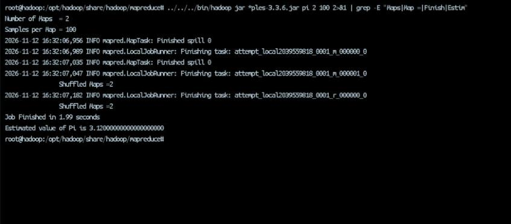
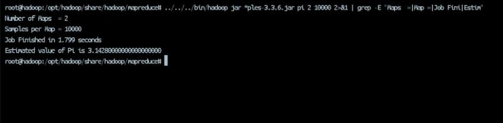

# Equipo 4 - Pi por Monte Carlo

Repositorio original: https://github.com/maferro07/bda-equipo-4-pi

## Ejercicio
1. Ejecutar el ejemplo `pi` con 2 tareas Map y 100 muestras por tarea.
2. Ejecutarlo de nuevo cambiando las muestras a 10000 y comparar.
3. Responder las preguntas.
4. Incluir evidencias (comando, valor de Pi y tiempo).

## Comandos utilizados
Dentro del contenedor `hadoop`:
```
export JAVA_HOME=/usr/lib/jvm/java-17-openjdk-amd64
export PATH=$PATH:/opt/hadoop/bin
mkdir -p /home/hadoop/equipo4/staging

hadoop jar /opt/hadoop/share/hadoop/mapreduce/hadoop-mapreduce-examples-3.3.6.jar pi -Dmapreduce.framework.name=local -Dmapreduce.jobtracker.staging.root.dir=/home/hadoop/equipo4/staging 2 100

hadoop jar /opt/hadoop/share/hadoop/mapreduce/hadoop-mapreduce-examples-3.3.6.jar pi -Dmapreduce.framework.name=local -Dmapreduce.jobtracker.staging.root.dir=/home/hadoop/equipo4/staging 2 10000
```
También está en [`scripts/ejecutar.sh`](scripts/ejecutar.sh).

## Resultados

| Prueba | Maps | Muestras por Map | Muestras totales | Pi estimado | Error vs 3.14159 | Tiempo |
|---|---|---|---|---|---|---|
| 1 | 2 | 100 | 200 | 3.1200 | 0.0216 | 1.99 s |
| 2 | 2 | 10000 | 20000 | 3.1428 | 0.0012 | 1.799 s |

### Evidencias

**Prueba 1 (100 muestras)**



**Prueba 2 (10000 muestras)**



### Comparación
Con 200 muestras se obtuvo 3.12 (error de ~0.02). Con 20,000 muestras se obtuvo 3.1428,
mucho más cerca del valor real (error de ~0.001). El tiempo casi no cambió (~2 s), porque en
modo local la mayor parte del tiempo es el arranque del trabajo, no el cálculo.

## Respuestas

1. **¿Qué función cumplen las tareas Map?**
   Cada tarea Map genera puntos aleatorios dentro de un cuadrado y cuenta cuántos caen dentro
   de un cuarto de círculo y cuántos quedan fuera. Cada Map trabaja con sus propias muestras.

2. **¿Para qué sirve la fase Reduce?**
   Junta los conteos de todas las tareas Map (puntos dentro y fuera) y con el total calcula
   Pi ≈ 4 × (puntos dentro / puntos totales).

3. **¿Qué sucede cuando aumentamos la cantidad de muestras?**
   La estimación se acerca más al valor real de Pi (de 3.12 a 3.1428 en nuestras pruebas).
   Como el método es aleatorio, no siempre mejora en cada ejecución, pero en general el error disminuye.

4. **¿Por qué el resultado no es exactamente 3.14159?**
   Porque Monte Carlo es un método de aproximación: usa una cantidad finita de puntos
   aleatorios, así que siempre queda un pequeño error que depende de cuántos puntos se usen
   y de cómo se distribuyan.

5. **¿Qué ventajas ofrece MapReduce para procesar grandes cantidades de datos?**
   Divide el trabajo en muchas tareas que se ejecutan en paralelo (incluso en varias
   computadoras de un clúster), y luego combina los resultados. Así se pueden procesar
   millones de muestras o datos más rápido y de forma escalable.
